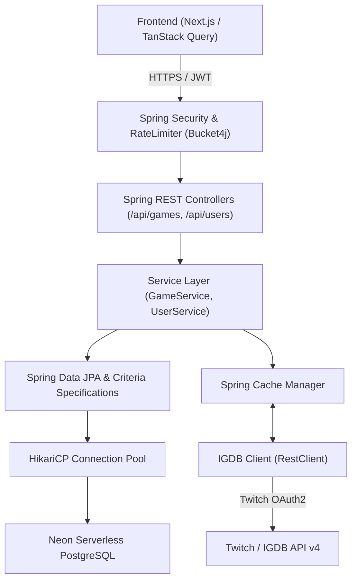

# Excelsior

[](https://openjdk.org/)
[](https://spring.io/projects/spring-boot)
[](https://neon.tech/)
[](https://spring.io/projects/spring-security)
[](LICENSE)
[](Dockerfile)

> **Excelsior** is a high-performance backend REST API powering a personal video game library, backlog tracker, and interactive drag-and-drop tier list manager. Built with **Spring Boot** and **Java 25**, it seamlessly integrates with the **Twitch IGDB API** to deliver rich video game metadata, playtime statistics, cover art, and media.

---

## Table of Contents

- [Overview](#-overview)
- [Key Features](#-key-features)
- [System Architecture](#-system-architecture)
- [Tech Stack](#-tech-stack)
- [Database & Resilience Engineering](#-database--resilience-engineering)
- [API Reference](#-api-reference)
  - [Authentication & Users](#1-authentication--users-apiusers)
  - [Game Library & Tier List](#2-game-library--tier-list-apigames)
  - [Observability & Documentation](#3-observability--docs)
- [Configuration & Environment Variables](#-configuration--environment-variables)
- [Getting Started](#-getting-started)
  - [Prerequisites](#prerequisites)
  - [Local Installation](#local-installation)
  - [Running Tests](#running-tests)
- [Docker Deployment](#-docker-deployment)
- [Security & Rate Limiting](#-security--rate-limiting)
- [License](#-license)

---

## Overview

Excelsior serves as the core engine for organizing, evaluating, and tracking video game collections. It allows players to:
- Catalog games across custom progression statuses (**Playing**, **Completed**, **Backlog**, **Wishlist**, **Abandoned**).
- Rank games into classic tier lists (**S**, **A**, **B**, **C**, **D**, **None**) with real-time persistent ordering support for frontend drag-and-drop interfaces (`dnd-kit`).
- Query the global IGDB database in real time with automated Twitch OAuth2 token management and caching.
- Dynamically filter large personal game collections across multiple facets (ratings, genres, release years, completion times, and platforms).

---

## Key Features

- **IGDB / Twitch OAuth2 Integration**: Seamless upstream queries to IGDB v4 for game summaries, engines, companies, cover art, 1080p screenshots, and playtime statistics (HowLongToBeat / TimeToBeat integration).
- **Interactive Tier List Engine**: Real-time batch position updating (`/api/games/tier-positions`) specifically designed for drag-and-drop Kanban / tier-list boards.
- **Dynamic Multi-Faceted Querying**: Powered by Spring Data JPA Specifications and Criteria API—enabling concurrent filtering across title, genre, platform, completion time, release date/year, tier, and rating ranges.
- **Stateless JWT Security**: Role-based access control (`ROLE_USER`, `ROLE_ADMIN`) with BCrypt password hashing and custom token filter chain.
- **Token-Bucket Rate Limiting**: In-memory rate limiting using **Bucket4j** (20 req/min greedy refill per client IP) on sensitive endpoints (`/search`, `/check-username`, `/add`).
- **Resilient Cloud Persistence**: Fine-tuned HikariCP connection pooling and batch fetching optimized for serverless **Neon PostgreSQL** cold starts.
- **RFC 7807 Problem Details**: Standardized REST error envelopes across all exception handlers.
- **Interactive API Docs**: Built-in Swagger UI and OpenAPI 3.0 specification via SpringDoc.

---

## System Architecture

Excelsior follows a clean, layered domain-driven structure:

```
dev.abdulrahman.excelsior/
├── business/                     # Core domain models & business logic
│   ├── game/                     # Game entity, GameService, GameTier, GameStatus
│   └── user/                     # User entity, UserService, UserRole, UserDetails
├── configuration/                # WebMvc, CORS, and Cache configurations
├── integration/                  # Upstream clients (Twitch OAuth2 & IGDB API v4)
├── mapper/                       # Entity-to-DTO and Upstream-to-Domain mappers
├── persistence/                  # Spring Data JPA Repositories & Criteria Specifications
├── presentation/                 # REST Controllers & Global Problem Details handlers
└── security/                     # JWT Service, Authentication Filters, & Bucket4j Interceptors
```



---

## Tech Stack

### Core & Frameworks
- **Language**: Java 25 (Temurin JDK)
- **Framework**: Spring Boot 4.x / 3.x (`spring-boot-starter-webmvc`)
- **Security**: Spring Security 6 & JJWT (0.12.6)
- **Data Persistence**: Spring Data JPA & Hibernate
- **Database**: PostgreSQL (Hosted on Neon)
- **Connection Pool**: HikariCP (configured for serverless resilience)

### API & Integrations
- **External Integration**: IGDB API v4 via Twitch Developer OAuth2
- **HTTP Client**: Spring 6 `RestClient`
- **Rate Limiting**: Bucket4j (`bucket4j-core`)
- **Documentation**: SpringDoc OpenAPI UI / Swagger 3
- **Validation**: Jakarta Bean Validation (`spring-boot-starter-validation`)
- **Monitoring**: Spring Boot Starter Actuator

### Testing & Tooling
- **Testing**: JUnit 5, Mockito, Spring Boot Test, Spring WebMvc Test
- **Mocking**: OkHttp MockWebServer (Twitch & IGDB mock servers)
- **In-Memory Testing DB**: H2 Database (configured with `MODE=PostgreSQL`)
- **Build Tool**: Apache Maven (`mvnw`)
- **Containerization**: Multi-stage Docker build

---

## Database & Resilience Engineering

Because Excelsior runs in the cloud against **Neon Serverless PostgreSQL**, the persistence layer implements specific optimizations:

1. **HikariCP Dynamic Sizing**:
   - `maximum-pool-size=10` and `minimum-idle=2` prevent aggressive connection eviction while maintaining rapid wake-up latency when serverless database compute resumes from idle.
   - `keepalive-time=30000` prevents idle TCP connection dropouts from cloud firewalls.
2. **N+1 Prevention via Batch Fetching**:
   - High-cardinality element collections (`genres`, `companies`, `screenshotUrls`, `platforms`) are loaded lazily.
   - `hibernate.default_batch_fetch_size=25` batches collection queries into single `IN` queries.
3. **Database Constraints & Indexes**:
   - Unique composite constraint on `(user_id, igdb_id)` ensures duplicate games cannot be cataloged by the same user.
   - Indexed foreign key `idx_game_user_id` optimizes per-user lookups.
   - Calculated SQL formula (`@Formula`) maps letter tiers (`S` → 6, `A` → 5, ..., `D` → 2, `NONE` → 1) to enable native SQL ordering.

---

## API Reference

Interactive Swagger documentation is available at `/swagger-ui/index.html`.

### 1. Authentication & Users (`/api/users`)

| Method | Endpoint | Access | Description |
|---|---|---|---|
| `POST` | `/api/users/register` | Public | Register a new user account |
| `POST` | `/api/users/login` | Public | Authenticate user credentials and return a Bearer JWT |
| `GET` | `/api/users/check-username` | Public (Rate Limited) | Check whether a username is available |
| `PATCH` | `/api/users` | Authenticated | Update username or password for current authenticated user |
| `GET` | `/api/users` | Admin | Retrieve a list of all registered users |
| `PATCH` | `/api/users/{id}` | Admin | Update user details by ID |
| `DELETE` | `/api/users/{id}` | Admin | Delete user account and cascade delete their games |

### 2. Game Library & Tier List (`/api/games`)

| Method | Endpoint | Access | Description |
|---|---|---|---|
| `GET` | `/api/games/search` | Public (Rate Limited) | Search global IGDB database (supports `query`, `limit`, `offset`) |
| `GET` | `/api/games` | Authenticated | Paginated query of user's library with dynamic multi-criteria filters |
| `GET` | `/api/games/{id}` | Authenticated | Get full details for a game in user's library |
| `POST` | `/api/games` | Authenticated | Batch add games to user library |
| `PUT` | `/api/games/{id}` | Authenticated | Full update of game metadata |
| `PATCH` | `/api/games/{id}` | Authenticated | Update status (`PLAYING`, `COMPLETED`, etc.) or tier (`S`, `A`, etc.) |
| `PATCH` | `/api/games/tier-positions` | Authenticated | Batch reorder game positions within tiers (drag-and-drop sync) |
| `DELETE` | `/api/games/{id}` | Authenticated | Remove game from library |
| `GET` | `/api/games/stats` | Authenticated | Get summary counts grouped by status and tier |

#### Available Dynamic Filter Parameters (`GET /api/games`)
- `nameContains` (string)
- `genreContains` (string)
- `platformContains` (string)
- `minRating` / `maxRating` (double)
- `minLengthNormal` / `maxLengthNormal` (playtime hours)
- `minLengthComplete` / `maxLengthComplete` (completionist hours)
- `minDate` / `maxDate` (`YYYY-MM-DD`)
- `minYear` / `maxYear` (integer)
- `tier` (`S`, `A`, `B`, `C`, `D`, `NONE`)
- `status` (`PLAYING`, `COMPLETED`, `BACKLOG`, `WISHLIST`, `ABANDONED`)
- `page`, `size`, `sort` (Spring Data standard pagination)

### 3. Observability & Docs

| Method | Endpoint | Description |
|---|---|---|
| `GET` | `/actuator/health` | Health check endpoint for cloud platform probes |
| `GET` | `/swagger-ui/index.html` | Swagger UI interface |
| `GET` | `/v3/api-docs` | OpenAPI 3 JSON document |

---

## Configuration & Environment Variables

The application is configured via environment variables in [application.properties](src/main/resources/application.properties):

| Variable | Description | Example / Default |
|---|---|---|
| `PORT` | Application HTTP port | `8080` |
| `NEON_URL` | PostgreSQL JDBC connection URL | `jdbc:postgresql://ep-xyz.neon.tech/excelsior?sslmode=require` |
| `NEON_USERNAME` | Database username | `neondb_owner` |
| `NEON_PASSWORD` | Database password | `your_neon_password` |
| `IGDB_CLIENT_ID` | Twitch Developer Application Client ID | `your_twitch_client_id` |
| `IGDB_CLIENT_SECRET` | Twitch Developer Application Client Secret | `your_twitch_client_secret` |
| `JWT_SECRET` | HMAC-SHA secret key (at least 256 bits) | `your_super_secret_base64_or_hex_string_key` |

---

## Getting Started

### Prerequisites
- **JDK 25** installed
- **Git**
- Twitch Developer Account (for [IGDB API](https://api-docs.igdb.com/))
- PostgreSQL instance (local or hosted on [Neon](https://neon.tech/))

### Local Installation

1. **Clone the repository**:
   ```bash
   git clone https://github.com/AbdulrahmanAlaamry/Excelsior.git
   cd Excelsior
   ```

2. **Configure environment variables**:
   Create local environment variables or export them in your shell:
   ```bash
   export PORT=8080
   export NEON_URL="jdbc:postgresql://localhost:5432/excelsior"
   export NEON_USERNAME="postgres"
   export NEON_PASSWORD="password"
   export IGDB_CLIENT_ID="your_client_id"
   export IGDB_CLIENT_SECRET="your_client_secret"
   export JWT_SECRET="superSecretKeyThatIsAtLeast32BytesLongForHmacSha256!"
   ```

3. **Build the application**:
   ```bash
   ./mvnw clean package
   ```

4. **Run the application**:
   ```bash
   ./mvnw spring-boot:run
   ```
   The API will start at `http://localhost:8080`.

### Running Tests

The test suite runs against an isolated, in-memory H2 database running in PostgreSQL compatibility mode, utilizing OkHttp `MockWebServer` for Twitch/IGDB API mocks:

```bash
./mvnw test
```

---

## Docker Deployment

The project includes an optimized multi-stage [Dockerfile](Dockerfile) using `eclipse-temurin:25-jdk` for building and `eclipse-temurin:25-jre` for a minimal, lightweight production footprint.

### Build and Run with Docker:

```bash
# Build the Docker image
docker build -t excelsior-backend .

# Run the container
docker run -p 8080:8080 \
  -e NEON_URL="jdbc:postgresql://ep-xyz.neon.tech/excelsior?sslmode=require" \
  -e NEON_USERNAME="neondb_owner" \
  -e NEON_PASSWORD="your_password" \
  -e IGDB_CLIENT_ID="your_client_id" \
  -e IGDB_CLIENT_SECRET="your_client_secret" \
  -e JWT_SECRET="your_secret_key" \
  excelsior-backend
```

---

## Security & Rate Limiting

- **JWT Authentication**: Secure Bearer tokens with 24-hour expiration (`jwt.expiration-ms=86400000`).
- **Rate Limiting**: To prevent scraping and upstream Twitch API quota exhaustion, Bucket4j enforces an IP-based token-bucket filter allowing 20 requests per minute with greedy refill on:
  - `/api/games/search`
  - `/api/users/check-username`
  - `/api/games` (mutating endpoints)

---

## License

This project is licensed under the MIT License. See [LICENSE](LICENSE) for details.
